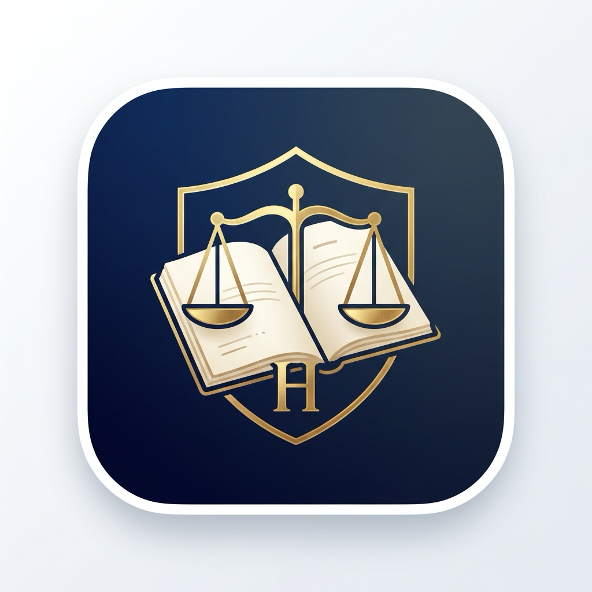

<p align="center">
  
</p>

<h1 align="center">LexHarness</h1>

<p align="center">
  <b>Free, open-source legal drafting and review workspace built to help solo practitioners, public defenders, and small law firms safely put AI to work for their clients.</b>
</p>

<p align="center">
  <a href="https://bentito.github.io/free-legal-assist/#tour"></a>
  <a href="https://github.com/bentito/free-legal-assist/releases/latest"></a>
  <a href="LICENSE"></a>
  <a href="https://github.com/bentito/free-legal-assist/releases/latest"></a>
  <a href="https://github.com/bentito/free-legal-assist/releases/latest"></a>
  <a href="https://github.com/bentito/free-legal-assist/discussions"></a>
</p>

<p align="center">
  👉 <b>Want to see how it works before downloading? <a href="https://bentito.github.io/free-legal-assist/#tour">Launch the Interactive Web Tutorial &amp; Live Workspace Demo in your browser</a>.</b>
</p>

---

## 📥 Download LexHarness (or Try the Web Tour)

LexHarness is a desktop application for Mac and Windows. It comes pre-loaded with a complete sample matter (*John Doe v. State of Vermont* with police affidavits, body-camera transcripts, and sample suppression motions) so you can test the full workflow offline immediately—or you can [**step through the interactive 7-card Guided Tour on the web**](https://bentito.github.io/free-legal-assist/#tour) with zero installation.

| Platform | Recommended Installer | Alternative |
| :--- | :--- | :--- |
| **Web Browser** (No Install) | [**🧭 Launch Interactive Web Tour & UI Demo**](https://bentito.github.io/free-legal-assist/#tour) | [Read All 7 Tutorial Cards](https://bentito.github.io/free-legal-assist/#tour-guide) |
| **macOS** (Apple Silicon / M1, M2, M3, M4) | [**📥 Download `.dmg` Installer**](https://github.com/bentito/free-legal-assist/releases/download/v0.8.2/LexHarness-0.8.2-arm64.dmg) | [Portable `.zip`](https://github.com/bentito/free-legal-assist/releases/download/v0.8.2/LexHarness-0.8.2-arm64-mac.zip) |
| **Windows 10 / 11** (64-bit) | [**📥 Download `.exe` Installer**](https://github.com/bentito/free-legal-assist/releases/download/v0.8.2/LexHarness.Setup.0.8.2.exe) | [Portable `.zip`](https://github.com/bentito/free-legal-assist/releases/download/v0.8.2/LexHarness-0.8.2-win.zip) |

👉 *Looking for older versions or release notes? View all releases on the [Releases page](https://github.com/bentito/free-legal-assist/releases).*

---

## Why LexHarness Exists: Repurposing Coding Agents for Legal Work

Chatbots generate single-shot conversational replies from memory. By contrast, **software engineering coding agents**—such as **OpenAI Codex**, **Claude Code**, and **Antigravity**—are fundamentally built for multi-step task work: searching large repositories of files, running verification tools, checking exact line citations, and iteratively revising drafts.

**LexHarness repurposes these coding agents from software engineering to legal work** by pointing them at your discovery exhibits instead of source code and governing every turn with a 4-layer legal system prompt harness in Settings:
- **Practitioner Profiles (Default + Expanding Locales)**: Settings currently ship with built-in defaults for **Vermont Criminal Defense** and a plain **General Legal Practice** profile (civil litigation, commercial contracts, regulatory analysis), with profiles for many more locales and legal practice types coming soon—and every prompt layer is customizable today.
- **Grounded in Discovery Exhibits (Not Hallucinations)**: Instead of guessing facts from memory, agents search your indexed case files (`.docx`, `.pdf`, `.xlsx`, `.csv`, `.rtf`, `.txt`, `.md`) by Bates stamp so every factual claim is anchored to the record.
- **Parallel Second-Chair & Opposing Counsel Review**: Consumer chatbots act like agreeable yes-men. Before delivering a draft, LexHarness runs parallel **Citation & Record Auditor** and **Opposing Counsel** checks to cure weak inferences and citation errors, then presents side-by-side redlines and native Word (`.docx`) Tracked Changes.
- **Local-First Privilege & PII Shield**: Your matters and exhibits stay on your machine, and the **Privileged PII Shield** scrubs client names, SSNs, DOBs, and addresses locally before cloud dispatch.

---

## How LexHarness Compares to Standard Chatbots

| What Matters in Practice | Consumer Chatbots | LexHarness |
| :--- | :--- | :--- |
| **Factual Grounding** | Paraphrases or guesses without checking the record | Reads your case exhibits and cites exact Bates numbers, transcript lines, and timestamps |
| **Citation & Record Accuracy** | Single AI pass that can hallucinate authorities | **Automatic Peer Review**: A separate Citation Auditor checks every factual and legal claim before you finish |
| **Stress-Testing Arguments** | Tends to validate whatever you ask | **Opposing Counsel Review**: Challenges your draft from the perspective of opposing counsel or the bench |
| **Reviewing Revisions** | Forces you to copy-paste blocks of text back and forth | Built-in **Redline & Document Editor** shows exact additions and deletions side by side |
| **Local Court & Practice Rules** | Defaults to generic or federal summaries | Tailored **Practitioner Profiles** for your specific jurisdiction, court rules, and citation format |
| **Client Confidentiality** | Stored in consumer browser history and cloud tabs | **Local-First**: Your matters, exhibits, and drafts live on your computer, with automatic client-name scrubbing |
| **Cost** | Expensive per-seat enterprise legal tech contracts | Free and open-source—use your own AI accounts or run local models on your machine |

---

## How It Works for Your Practice

### 1. Grounded in Your Discovery and Exhibits
Organize your work by matter and docket. Load police reports, affidavits, deposition transcripts, contracts, or exhibits directly into your case file. When you ask LexHarness to draft a motion, brief, or client memo, it searches your actual record and anchors factual assertions to specific Bates numbers, pages, and timestamps—while building a clean **Fact Chronology** along the way.

### 2. Automatic Second-Chair & Opposing Counsel Review
Solo and small-firm lawyers don't always have a colleague down the hall to mark up a brief before filing. In LexHarness, every draft can automatically go through two independent review checks before it lands on your desk:
- **Citation & Record Auditor**: Checks that every factual claim matches your exhibits and flags unsupported or questionable citations.
- **Opposing Counsel & Judicial Perspective**: Anticipates how the other side—or the judge—will attack your argument, flagging procedural weak spots so the draft can be strengthened immediately.

### 3. Redlines and In-Place Document Editing
Review your work product in a dedicated document pane. Toggle between the initial draft, the peer-reviewed revision, and a **full redline view** showing every change made to address review objections. You can edit the text directly at any time and re-run peer review with a single click whenever you add new arguments.

### 4. Built Around Your Jurisdiction and Practice Area
Every court has its own rules, constitutional doctrines, and citation habits. LexHarness lets you select or customize **Practitioner Profiles**—defining your governing forum, citation manual, and practice focus (such as criminal defense motions to suppress, civil litigation, contract review, or discovery analysis) so you never have to re-explain your local rules in every prompt.

### 5. Protect Client Privilege
Your case database and documents stay on your computer. Before a question is sent to an external AI model, LexHarness can automatically replace client and party names with neutral placeholders and restore them locally when the draft returns. See our [Security & Confidentiality Policy](SECURITY.md) for details.

---

## 💬 Community & Discussion

Have an idea for a practice-area profile, want to ask a question, or discuss how you use LexHarness in your practice?

- **Join the conversation**: Visit [**GitHub Discussions**](https://github.com/bentito/free-legal-assist/discussions) to connect with other practitioners and contributors.
- **Report an issue**: Use our [Issue Tracker](https://github.com/bentito/free-legal-assist/issues) to report bugs or request new features.
- **Contribute**: Read our [Contributor Guide (CONTRIBUTING.md)](CONTRIBUTING.md) to see how lawyers and developers can participate.

---

## 🛠️ For Developers: Building From Source

If you want to contribute code or build the latest development version:

### Prerequisites
- [Node.js](https://nodejs.org/) (v20 or newer)
- npm (v10+)
- Git

### Quick Setup
```bash
# Clone the repository
git clone https://github.com/bentito/free-legal-assist.git
cd free-legal-assist

# Install dependencies
npm install

# Run in live development mode (hot reload)
npm run dev

# Or run directly
npm start

# Run automated checks
npm run typecheck
npm test
```

### Packaging Installers Locally
```bash
# Package for macOS (Apple Silicon .dmg)
npm run dist:mac

# Package for Windows (.exe installer)
npm run dist:win
```

---

## License

LexHarness is free and open-source software released under the [Apache License 2.0](LICENSE).
