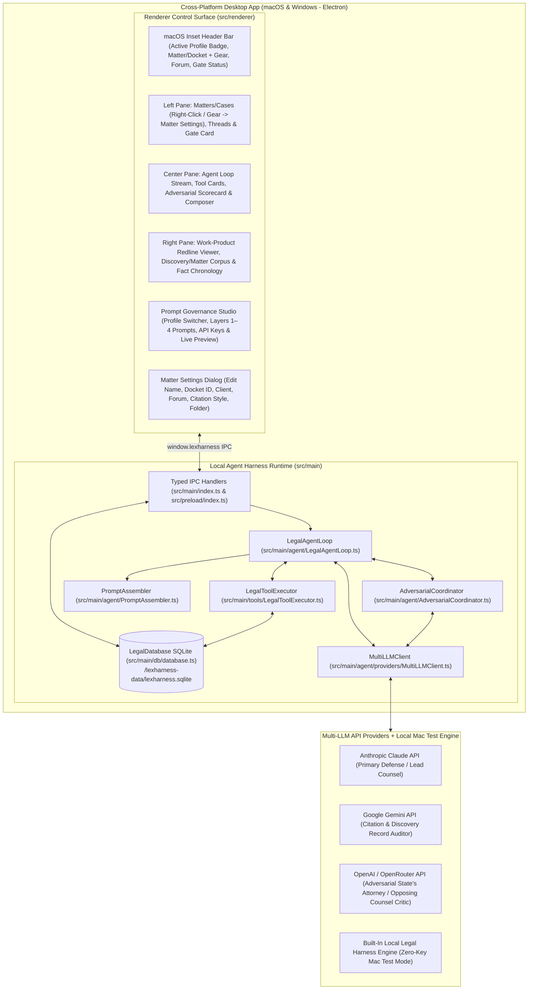

# Architecture & Implementation Plan: LexHarness — Legal Agent Harness Control Surface

## 1. Executive Summary & Core Vision

**LexHarness** is a cross-platform (**macOS and Windows**) desktop application that provides lawyers with a dedicated **Agent Harness Control Surface**—an autonomous, multi-step workspace for legal research, record investigation, citation verification, and work-product drafting:

1. **Local Client Agent Loop**: Runs natively on the lawyer's Mac or Windows machine inside the Electron main process, maintaining matter and thread state in a local SQLite database (`sql.js`), executing local legal tools (`list_matter_documents`, `search_matter_corpus`, `read_document_pages`, `verify_citation_lookup`, `propose_document_redline`, `record_chronology_fact`), and calling LLM provider APIs directly from the client.
2. **Practitioner Profiles & User-Governed Legal System Prompts**: All system prompts, task presets, default jurisdictions, and critic instructions are organized into selectable **Practitioner Profiles** and exposed directly in the application's **Prompt Governance Studio** (Settings).
   - **1st in Pick List (Default Profile)**: **`Vermont Criminal Defense Lawyer`** — Pre-configured for Vermont Superior Court, Criminal Division practice, grounding analysis in the Vermont Constitution (specifically **Chapter I, Article 11** search-and-seizure protections, which are broader than the federal Fourth Amendment, and **Article 10** trial/due process rights), the **Vermont Rules of Criminal Procedure (V.R.Cr.P.)**, **Vermont Rules of Evidence (V.R.E.)**, **Title 13 (`13 V.S.A.`)** and **Title 23 (`23 V.S.A.`)**, and Vermont Supreme Court precedent.
   - **2nd in Pick List**: **`General Legal Practice`** — A versatile civil, transactional, and regulatory profile with general practice presets.
3. **Re-Visiting & Editing Matter / Docket Settings**: Lawyers can revisit and update any Matter's settings at any time by **right-clicking** the Matter in the left sidebar (or clicking the **Settings gear icon** on the Matter card or top header bar) to open the **Matter Settings Dialog** and edit the **Matter/Case Name**, **Docket ID / Matter Number**, **Client / Defendant Name**, **Governing Jurisdiction & Forum**, **Citation Style**, **Default Task Persona**, and **Local Folder Path**.
4. **Default Multi-LLM Adversarial Review Gate**: Before any final answer or drafted legal artifact is presented to the user, the local agent loop automatically intercepts the candidate output and routes it in parallel through independent reviewer models (e.g., Anthropic Claude as Primary Defense/Lead Counsel, Google Gemini 2.5 Pro as **Citation & Record Auditor**, and OpenAI o3-mini / GPT-4o as **Adversarial Opposing Counsel / State's Attorney & Trial Judge Critic**) to catch unsupported citations, record mismatches, constitutional/procedural omissions, and drafting risks, forcing an automatic revision pass when material objections are raised.

---

## 2. Clean-Slate Desktop Architecture

The application is built on **Electron 33 + React 18 + Vite 6 + TypeScript 5 + Tailwind CSS + SQLite (`sql.js`)**, running a local orchestration engine and tool runner directly in the Electron Main Process and communicating with the React Control Surface over a typed `contextBridge` IPC layer.



---

## 3. Practitioner Profiles Architecture (Default: Vermont Criminal Defense Lawyer)

> [!IMPORTANT]
> **UI Badge & Naming Rule**: Never display meta-instructions like *"Profile v1 • Zero Software Prompts"* in UI badges or profile titles. The UI displays the active **Practitioner Profile** name (e.g., **`Profile: Vermont Criminal Defense Lawyer`** or **`Profile: General Legal Practice`**).

The application ships with a **Practitioner Profile Pick List** in the **Prompt Governance Studio** (and visible in the top header bar). Switching profiles updates the active 4-layer system prompts, task presets, default jurisdiction/citation rules for new matters, and sample quick prompts.

### Profile 1 (Default — 1st in Pick List): `Vermont Criminal Defense Lawyer` (`vt-criminal-defense`)

Designed so a practicing Vermont criminal defense attorney immediately sees familiar procedural rules, constitutional doctrines, statutory titles, and defense workflows without surprise:

- **Default Jurisdiction & Forum (Layer 3)**:
  - **Forum**: `Vermont Superior Court, Criminal Division / Vermont Supreme Court (Vt. Const. ch. I, art. 11 & 10; V.R.Cr.P.)`
  - **Citation Style**: `Vermont Supreme Court Public Domain / Bluebook (e.g., 2007 VT 16, ¶ 14; 13 V.S.A. § 7554; V.R.Cr.P. 12(b)(3))`
- **Layer 1 — Core Legal Mandate & Ethical Guardrails (`coreLegalMandate`)**:
  - Establishes the agent's role as rigorous **Vermont Criminal Defense Counsel & Research Harness**.
  - **Vermont Constitutional Primacy (`Vt. Const. ch. I, art. 11` & `art. 10`)**: Instructs the agent to always analyze search, seizure, exit orders, canine sniffs, warrantless automobile searches, and digital privacy under **Article 11 of the Vermont Constitution** independently from and prior to the federal Fourth Amendment—recognizing that the Vermont Supreme Court rejects numerous federal doctrines (e.g., requiring a showing of exigency for warrantless vehicle seizures under *State v. Savva* / *State v. Bauder*, requiring reasonable suspicion for exit orders under *State v. Sprague*, and rejecting the federal *Leon* good-faith exception under *State v. Oakes*).
  - **Strict Discovery & Record Grounding**: Every factual assertion must cite the exact page, timestamp, or Bates number from Law Enforcement Affidavits of Probable Cause, Body-Worn Camera (BWC) / Cruiser Dashcam transcripts, V.R.Cr.P. 15 deposition transcripts, or dispatch logs. Never invent a Vermont case citation (`20XX VT XX`), statute (`13 V.S.A.`, `23 V.S.A.`, `18 V.S.A.`), or record fact.
- **Layer 2 — Task Presets (`practiceAreaPresets`) for `Vermont Criminal Defense Lawyer`**:
  1. **`vt_suppression_art11` — Motion to Suppress & Dismiss (Art. 11 / 4th Amend. / V.R.Cr.P. 12)**:
     - Focuses on challenging motor vehicle stops, expansion of stops/exit orders (*State v. Sprague*, 2003 VT 20), warrantless searches (*State v. Bauder*, 2007 VT 16), defective search warrants / lack of probable cause nexus, *Miranda* / Voluntariness / Public Defender Act (`13 V.S.A. § 5234`), and motions to dismiss for lack of a prima facie case under **V.R.Cr.P. 12(d)**.
  2. **`vt_bail_conditions` — Bail, Hold-Without-Bail & Conditions of Release (`13 V.S.A. §§ 7553a, 7554`)**:
     - Focuses on statutory presumption of release on personal recognizance or unsecured appearance bond (`13 V.S.A. § 7554`), challenging restrictive conditions unsupported by individualized record findings, weight-of-the-evidence analysis under `§ 7553` / `§ 7553a`, and expedited bail appeals to a single Justice of the Vermont Supreme Court (`13 V.S.A. § 7556`).
  3. **`vt_discovery_impeachment` — Discovery Audit, V.R.Cr.P. 15 Depositions & BWC Impeachment**:
     - Focuses on cross-referencing the Investigating Officer's Affidavit of Probable Cause against Body-Worn Camera (BWC) transcripts, dispatch CAD logs, V.R.Cr.P. 15 sworn depositions, and **V.R.Cr.P. 16** prosecutorial disclosure obligations to surface material omissions, timeline contradictions, and impeachment matrices.
  4. **`vt_plea_sentencing` — Plea Negotiations, Deferred Sentences & Collateral Consequences (`13 V.S.A. § 7041`)**:
     - Focuses on statutory maximums/minimums under Title 13/18/23, Deferred Sentence Agreements (`13 V.S.A. § 7041`), Youthful Offender status (`33 V.S.A. § 5280`), expungement/sealing eligibility (`13 V.S.A. § 7602`), and license suspension / immigration collateral consequences.
- **Layer 4 — Adversarial Reviewer Prompts for `Vermont Criminal Defense Lawyer`**:
  - **Critic #1 (`criticCitationAuditorPrompt` — Vermont Citation & Discovery Record Auditor)**:
    - Audits every cited Vermont Supreme Court decision (`VT` public domain cites and `A.2d`/`A.3d` reporters), `V.S.A.` statutory section, `V.R.Cr.P.` rule, and factual pinpoint against the Affidavit of Probable Cause, BWC transcript, and V.R.Cr.P. 15 deposition record. Flags any conflation of federal Fourth Amendment standards with Vermont Article 11 jurisprudence.
  - **Critic #2 (`criticOpposingCounselPrompt` — Deputy State's Attorney & Criminal Division Judge Critic)**:
    - Simulates an experienced **Vermont Deputy State's Attorney** opposing the motion and a **Vermont Superior Court Criminal Division Judge** scrutinizing the filing. Attacks weak factual inferences, raises inevitable discovery / independent source / attenuation arguments, tests totality-of-the-circumstances articulable suspicion, and forces the defense draft to preemptively neutralize the State's strongest counterarguments.
- **Default Seeded Matter for `Vermont Criminal Defense Lawyer`**:
  - **Matter**: *State of Vermont v. Marcus Thorne* (`Docket No. 26-CR-04118 (Chittenden Unit)`, Vermont Superior Court, Criminal Division)
  - **Indexed Discovery Corpus**:
    1. `01_Affidavit_of_Probable_Cause_Trp_Keller.pdf` (`STATE-0001 to STATE-0005` — VSP Trooper Keller's sworn affidavit following an I-89 Southbound nighttime traffic stop in Colchester, exit order, and warrantless vehicle search).
    2. `02_BWC_and_Cruiser_Audio_Transcript.pdf` (`STATE-BWC-0001 to 0014` — Body-Worn Camera transcript revealing timestamp discrepancies and showing the Trooper ordered Mr. Thorne out of the vehicle before observing any indicators of impairment, contradicting Paragraph 5 of the Affidavit).
    3. `03_VRCrP15_Deposition_Trooper_Keller.pdf` (`DEF-DEP-0001 to 0032` — Rule 15 deposition where Trooper Keller concedes the exit order was based solely on out-of-state plates and refusal to answer itinerary questions, and no warrant or exigency existed prior to unlocking and searching the center console).
    4. `04_Vermont_Article11_Authority_Compendium.md` (`AUTH-VT-0001 to 0008` — *State v. Sprague*, 2003 VT 20; *State v. Bauder*, 2007 VT 16; *State v. Savva*, 159 Vt. 75 (1991); *State v. Oakes*, 157 Vt. 171 (1991); V.R.Cr.P. 12(b)(3) & 12(d)).
    5. `05_Draft_Motion_to_Suppress_and_Dismiss.md` (`WP-THORNE-0001` — Defense Motion to Suppress & Dismiss with Version 1 pre-review and Version 2 post-adversarial cured redline snapshots).

---

### Profile 2 (2nd in Pick List): `General Legal Practice` (`general-legal-practice`)

Provides a clean, general-purpose profile for civil, commercial, regulatory, and general litigation practitioners:

- **Default Jurisdiction & Forum (Layer 3)**:
  - **Forum**: `State & Federal General Jurisdiction (Configurable per Matter)`
  - **Citation Style**: `The Bluebook (21st Ed.)`
- **Layer 1 — Core Legal Mandate & Ethical Guardrails**:
  - General legal research and drafting discipline: strict citation and record grounding, mandatory pinpoint citations, explicit `[UNVERIFIED AUTHORITY]` flagging, distinction between binding and persuasive authority, and CRAC/IRAC structure.
- **Layer 2 — Generic Task Presets (`practiceAreaPresets`)**:
  1. **`general_litigation` — Civil Litigation & Motion Practice**: Pleadings, dispositive motions, standards of review, and record citations.
  2. **`general_transactional` — Transactional & Contract Drafting**: Commercial agreements, risk allocation, indemnification, and redline explanations.
  3. **`general_regulatory` — Statutory & Regulatory Compliance**: Statutory interpretation, administrative rules, and compliance checklists.
  4. **`general_investigation` — Fact & Record Chronology Investigation**: Synthesizing exhibits, transcripts, and documents into chronological timelines.
- **Layer 4 — Adversarial Reviewer Prompts**:
  - **Critic #1**: *Independent Citation & Record Auditor*
  - **Critic #2**: *Adversarial Opposing Counsel & Reviewing Partner*
- **Secondary Seeded Matter**:
  - *Apex Biometrics v. Meridian Cloud Systems* (`2026-CV-04192-DEL`) remains available in the Matter Switcher as a civil/commercial sample matter.

---

## 4. Re-Visiting & Editing Matter Settings (`legal:update-matter` & Matter Settings Dialog)

Lawyers frequently need to revisit a Matter to update the case caption, docket number, client name, assigned court unit/forum, citation style, default task persona, or local folder path:

- **UI Entry Points**:
  1. **Right-Click Context Menu**: Right-clicking any Matter card in the Left Sidebar (or the active Matter badge in the top header) opens a context menu with **`Matter Settings (Edit Name, Docket ID...)`**.
  2. **Settings Gear Icon**: Each Matter card in the Left Sidebar and the active Matter pill in the top header bar includes a direct **Settings gear icon** that opens the **Matter Settings Dialog**.
- **Editable Fields in the Matter Settings Dialog (`UpdateMatterPayload`)**:
  - `name` (*Matter / Case Caption Name*, e.g., `State of Vermont v. Marcus Thorne`)
  - `clientName` (*Client / Defendant Name*, e.g., `Marcus Thorne (Defendant)`)
  - `matterNumber` (*Docket ID / Matter Number*, e.g., `26-CR-04118 (Chittenden Unit)`)
  - `jurisdiction` (*Governing Jurisdiction & Court Forum*)
  - `citationStyle` (*Citation Style / Manual*)
  - `practiceArea` (*Default Task Persona*)
  - `folderPath` (*Local Matter Workspace Folder Path*)

---

## 5. Exact Repository File Structure

To build or rebuild the application identically from this document, the repository is structured as follows:

```text
free-legal-assist/
├── package.json                                  # Scripts: dev, build, start, package:mac, dist:mac, dist:win, typecheck, test
├── tsconfig.json                                 # Renderer & shared TypeScript config
├── tsconfig.node.json                            # Electron main & preload CommonJS TypeScript config
├── vite.config.ts                                # Vite React renderer config (port 5173, outDir: dist)
├── tailwind.config.js                            # Tailwind CSS config with dark slate/amber legal theme
├── postcss.config.js                             # PostCSS config
├── electron-builder.yml                          # Packaging config for macOS (.dmg/.zip) and Windows (nsis/.zip)
├── index.html                                    # Renderer HTML entry point
├── README.md                                     # Launch & test instructions
├── docs/
│   └── PLAN.md                                   # Architectural & implementation specification (mirrors this document)
└── src/
    ├── shared/
    │   └── types.ts                              # Shared domain & IPC contracts (PractitionerProfile, UpdateMatterPayload, etc.)
    ├── preload/
    │   └── index.ts                              # Electron contextBridge exposing window.lexharness
    ├── main/
    │   ├── index.ts                              # Electron main process, BrowserWindow, safeStorage & IPC handlers
    │   ├── db/
    │   │   ├── defaultLegalData.ts               # Built-in Practitioner Profiles (1. VT Criminal Defense, 2. General Practice) & seeded matters
    │   │   └── database.ts                       # SQLite (sql.js) persistence, profile switching, updateMatter & encrypted credentials
    │   ├── agent/
    │   │   ├── PromptAssembler.ts                # 4-layer dynamic legal system prompt composer
    │   │   ├── AdversarialCoordinator.ts         # Parallel Multi-LLM critic evaluation & JSON verdict parser
    │   │   ├── LegalAgentLoop.ts                 # Autonomous tool execution, primary draft, adversarial gate & revision loop
    │   │   └── providers/
    │   │       └── MultiLLMClient.ts             # Anthropic, OpenAI, Gemini, OpenRouter HTTP clients + Local Legal Engine
    │   ├── tools/
    │   │   └── LegalToolExecutor.ts              # 6 local legal tools operating against the Matter SQLite corpus
    │   └── __tests__/
    │       └── legalHarness.test.ts              # Vitest suite verifying profiles, Matter Settings updates, prompt assembly & loop
    └── renderer/
        ├── main.tsx                              # React DOM root mount
        ├── styles.css                            # Tailwind directives + macOS -webkit-app-region drag rules
        ├── App.tsx                               # Main 3-pane Legal Agent Control Surface UI + Right-Click & Matter Settings Dialog
        ├── lib/
        │   └── bridge.ts                         # Typed renderer wrapper around window.lexharness
        └── components/
            ├── PromptGovernanceModal.tsx         # Practitioner Profile selector + 6-tab modal for Layers 1–4 prompts, API keys & live preview
            └── RightWorkspacePane.tsx            # 3-tab right pane: Work-Product Redline, Matter Corpus & Chronology
```

---

## 6. Build, Verification & Cross-Platform Packaging Commands

1. **Install Dependencies**: `npm install`
2. **Typecheck & Unit Tests**: `npm run typecheck && npm test`
3. **Production Build**: `npm run build`
4. **Package Native macOS App Bundle (`release/mac-arm64/LexHarness.app`)**: `npm run package:mac`
5. **Package Distributable Installers**: `npm run dist:mac` (macOS `.dmg`/`.zip`) or `npm run dist:win` (Windows NSIS `.exe`/`.zip`).
