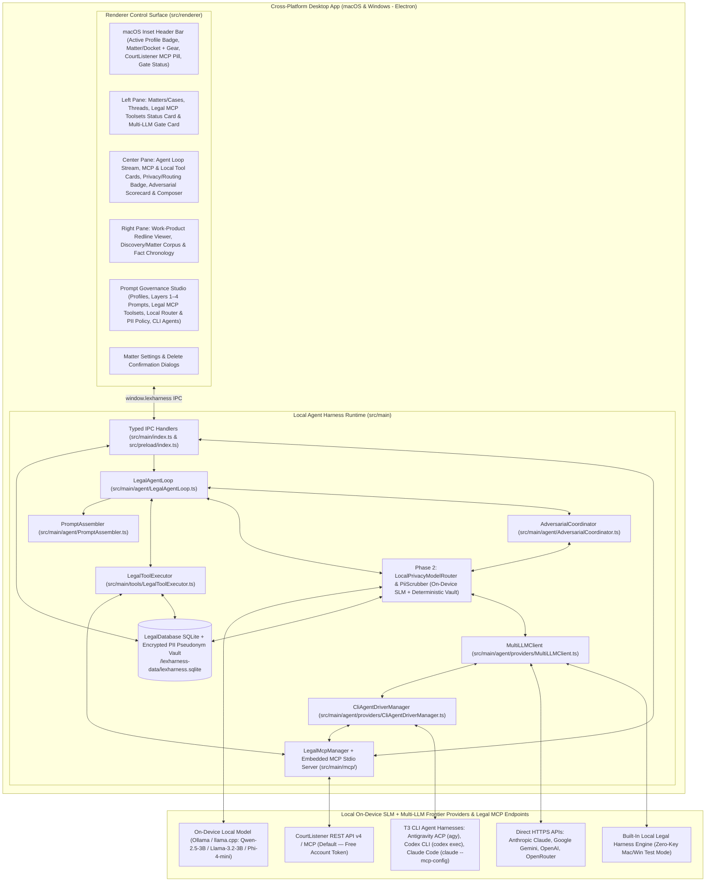
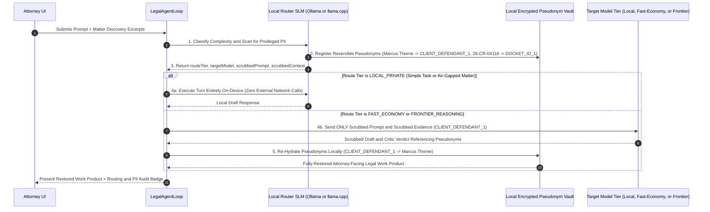

# Architecture & Implementation Plan: LexHarness — Legal Agent Harness Control Surface

## 1. Executive Summary & Core Vision

**LexHarness** is a cross-platform (**macOS and Windows**) desktop application that provides lawyers with a dedicated **Agent Harness Control Surface**—an autonomous, multi-step workspace for legal research, record investigation, citation verification, and work-product drafting:

1. **Local Client Agent Loop**: Runs natively on the lawyer's Mac or Windows machine inside the Electron main process, maintaining matter and thread state in a local SQLite database (`sql.js`), executing local legal tools and **Legal Model Context Protocol (MCP) Toolsets** (`courtlistener_lookup_citation`, `courtlistener_search_opinions`, `vt_statutes_lookup`, `list_matter_documents`, `search_matter_corpus`, `read_document_pages`, `propose_document_redline`, `record_chronology_fact`), and calling LLM provider APIs or T3-style CLI/ACP agent harnesses directly from the client.
2. **Practitioner Profiles & User-Governed Legal System Prompts**: All system prompts, task presets, default jurisdictions, and critic instructions are organized into selectable **Practitioner Profiles** and exposed directly in the application's **Prompt Governance Studio** (Settings).
   - **1st in Pick List (Default Profile)**: **`Vermont Criminal Defense Lawyer`** — Pre-configured for Vermont Superior Court, Criminal Division practice, grounding analysis in the Vermont Constitution (specifically **Chapter I, Article 11** search-and-seizure protections, which are broader than the federal Fourth Amendment, and **Article 10** trial/due process rights), the **Vermont Rules of Criminal Procedure (V.R.Cr.P.)**, **Vermont Rules of Evidence (V.R.E.)**, **Title 13 (`13 V.S.A.`)** and **Title 23 (`23 V.S.A.`)**, and Vermont Supreme Court precedent.
   - **2nd in Pick List**: **`General Legal Practice`** — A versatile civil, transactional, and regulatory profile with general practice presets.
3. **Re-Visiting, Editing & Deleting Matter / Docket Settings**: Lawyers can revisit and update any Matter's settings at any time by **right-clicking** the Matter in the left sidebar (or clicking the **Settings gear icon** on the Matter card or top header bar) to open the **Matter Settings Dialog** and edit the **Matter/Case Name**, **Docket ID / Matter Number**, **Client / Defendant Name**, **Governing Jurisdiction & Forum**, **Citation Style**, **Default Task Persona**, and **Local Folder Path**, or permanently delete a Matter through a **Confirm Permanent Matter Deletion** dialog.
4. **Default Legal MCP Toolsets (CourtListener Free-Account Default + Configurable Free & Authenticated MCPs)**: Every agent in LexHarness (including `Antigravity ACP`, `OpenAI Codex CLI`, `Anthropic Claude Code CLI`, and the `Local Legal Agent Loop`) is automatically provisioned and synced with legal MCP tooling—defaulting to **CourtListener (Free Law Project REST API v4 / MCP — Free Account Required)** alongside **Vermont Statutes & Rules MCP**, **U.S. GovInfo / eCFR MCP**, **Authenticated Commercial Citator MCP (Westlaw / Lexis+ AI / Fastcase)**, and custom user-registered MCP servers.
5. **Default Multi-LLM Adversarial Review Gate**: Before any final answer or drafted legal artifact is presented to the user, the local agent loop automatically intercepts the candidate output and routes it in parallel through independent reviewer models (e.g., Anthropic Claude as Primary Defense/Lead Counsel, Google Gemini 2.5 Pro as **Citation & Record Auditor**, and OpenAI o3-mini / GPT-4o as **Adversarial Opposing Counsel / State's Attorney & Trial Judge Critic**) to catch unsupported citations, record mismatches, constitutional/procedural omissions, and drafting risks, forcing an automatic revision pass when material objections are raised.
6. **Phase 2 — On-Device Local Model Router & Privileged PII Scrubbing Gateway**: A local small-model router running on the same computer as LexHarness (via Ollama / `llama.cpp` / ONNX) that (a) classifies request complexity to route simple tasks to fast/low-cost or local models and complex motions to frontier reasoning models, and (b) strips and pseudonymizes client PII and privileged identifiers before any payload is sent to external frontier models, re-hydrating the real client details locally upon return.

---

## 2. Clean-Slate Desktop Architecture

The application is built on **Electron 33 + React 18 + Vite 6 + TypeScript 5 + Tailwind CSS + SQLite (`sql.js`)**, running a local orchestration engine, Legal MCP manager, and tool runner directly in the Electron Main Process and communicating with the React Control Surface over a typed `contextBridge` IPC layer.



---

## 3. Practitioner Profiles Architecture (Default: Vermont Criminal Defense Lawyer)

> [!IMPORTANT]
> **UI Badge & Naming Rule**: Never display meta-instructions like *"Profile v1 • Zero Software Prompts"* in UI badges or profile titles. The UI displays the active **Practitioner Profile** name (e.g., **`Profile: Vermont Criminal Defense Lawyer`** or **`Profile: General Legal Practice`**).

The application ships with a **Practitioner Profile Pick List** in the **Prompt Governance Studio** (and visible in the top header bar). Switching profiles updates the active 4-layer system prompts, task presets, default jurisdiction/citation rules for new matters, and sample quick prompts.

### Profile 1 (Default — 1st in Pick List): `Vermont Criminal Defense Lawyer` (`vt-criminal-defense`)

Designed so a practicing Vermont criminal defense attorney immediately sees familiar procedural rules, constitutional doctrines, statutory titles, and defense workflows without surprise:

- **Default Jurisdiction & Forum (Layer 3)**:
  - **Forum**: `Vermont Superior Court, Criminal Division / Vermont Supreme Court (Vt. Const. ch. I, art. 11 & 10; V.R.Cr.P.)`
  - **Citation Style**: `Vermont Supreme Court Public Domain / Bluebook (e.g., 2007 VT 16, ¶ 14; 13 V.S.A. § 7554; V.R.Cr.P. 12(b)(3))`
- **Layer 1 — Core Legal Mandate & Ethical Guardrails (`coreLegalMandate`)**:
  - Establishes the agent's role as rigorous **Vermont Criminal Defense Counsel & Research Harness**.
  - **Vermont Constitutional Primacy (`Vt. Const. ch. I, art. 11` & `art. 10`)**: Instructs the agent to always analyze search, seizure, exit orders, canine sniffs, warrantless automobile searches, and digital privacy under **Article 11 of the Vermont Constitution** independently from and prior to the federal Fourth Amendment—recognizing that the Vermont Supreme Court rejects numerous federal doctrines (e.g., requiring a showing of exigency for warrantless vehicle seizures under *State v. Savva* / *State v. Bauder*, requiring reasonable suspicion for exit orders under *State v. Sprague*, and rejecting the federal *Leon* good-faith exception under *State v. Oakes*).
  - **Strict Discovery & Record Grounding**: Every factual assertion must cite the exact page, timestamp, or Bates number from Law Enforcement Affidavits of Probable Cause, Body-Worn Camera (BWC) / Cruiser Dashcam transcripts, V.R.Cr.P. 15 deposition transcripts, or dispatch logs. Never invent a Vermont case citation (`20XX VT XX`), statute (`13 V.S.A.`, `23 V.S.A.`, `18 V.S.A.`), or record fact.
- **Layer 2 — Task Presets (`practiceAreaPresets`) for `Vermont Criminal Defense Lawyer`**:
  1. **`vt_suppression_art11` — Motion to Suppress & Dismiss (Art. 11 / 4th Amend. / V.R.Cr.P. 12)**:
     - Focuses on challenging motor vehicle stops, expansion of stops/exit orders (*State v. Sprague*, 2003 VT 20), warrantless searches (*State v. Bauder*, 2007 VT 16), defective search warrants / lack of probable cause nexus, *Miranda* / Voluntariness / Public Defender Act (`13 V.S.A. § 5234`), and motions to dismiss for lack of a prima facie case under **V.R.Cr.P. 12(d)**.
  2. **`vt_bail_conditions` — Bail, Hold-Without-Bail & Conditions of Release (`13 V.S.A. §§ 7553a, 7554`)**:
     - Focuses on statutory presumption of release on personal recognizance or unsecured appearance bond (`13 V.S.A. § 7554`), challenging restrictive conditions unsupported by individualized record findings, weight-of-the-evidence analysis under `§ 7553` / `§ 7553a`, and expedited bail appeals to a single Justice of the Vermont Supreme Court (`13 V.S.A. § 7556`).
  3. **`vt_discovery_impeachment` — Discovery Audit, V.R.Cr.P. 15 Depositions & BWC Impeachment**:
     - Focuses on cross-referencing the Investigating Officer's Affidavit of Probable Cause against Body-Worn Camera (BWC) transcripts, dispatch CAD logs, V.R.Cr.P. 15 sworn depositions, and **V.R.Cr.P. 16** prosecutorial disclosure obligations to surface material omissions, timeline contradictions, and impeachment matrices.
  4. **`vt_plea_sentencing` — Plea Negotiations, Deferred Sentences & Collateral Consequences (`13 V.S.A. § 7041`)**:
     - Focuses on statutory maximums/minimums under Title 13/18/23, Deferred Sentence Agreements (`13 V.S.A. § 7041`), Youthful Offender status (`33 V.S.A. § 5280`), expungement/sealing eligibility (`13 V.S.A. § 7602`), and license suspension / immigration collateral consequences.
- **Layer 4 — Adversarial Reviewer Prompts for `Vermont Criminal Defense Lawyer`**:
  - **Critic #1 (`criticCitationAuditorPrompt` — Vermont Citation & Discovery Record Auditor)**:
    - Audits every cited Vermont Supreme Court decision (`VT` public domain cites and `A.2d`/`A.3d` reporters), `V.S.A.` statutory section, `V.R.Cr.P.` rule, and factual pinpoint against the Affidavit of Probable Cause, BWC transcript, and V.R.Cr.P. 15 deposition record. Flags any conflation of federal Fourth Amendment standards with Vermont Article 11 jurisprudence.
  - **Critic #2 (`criticOpposingCounselPrompt` — Deputy State's Attorney & Criminal Division Judge Critic)**:
    - Simulates an experienced **Vermont Deputy State's Attorney** opposing the motion and a **Vermont Superior Court Criminal Division Judge** scrutinizing the filing. Attacks weak factual inferences, raises inevitable discovery / independent source / attenuation arguments, tests totality-of-the-circumstances articulable suspicion, and forces the defense draft to preemptively neutralize the State's strongest counterarguments.
- **Default Seeded Matter for `Vermont Criminal Defense Lawyer`**:
  - **Matter**: *State of Vermont v. Marcus Thorne* (`Docket No. 26-CR-04118 (Chittenden Unit)`, Vermont Superior Court, Criminal Division)
  - **Indexed Discovery Corpus**:
    1. `01_Affidavit_of_Probable_Cause_Trp_Keller.pdf` (`STATE-0001 to STATE-0005` — VSP Trooper Keller's sworn affidavit following an I-89 Southbound nighttime traffic stop in Colchester, exit order, and warrantless vehicle search).
    2. `02_BWC_and_Cruiser_Audio_Transcript.pdf` (`STATE-BWC-0001 to 0014` — Body-Worn Camera transcript revealing timestamp discrepancies and showing the Trooper ordered Mr. Thorne out of the vehicle before observing any indicators of impairment, contradicting Paragraph 5 of the Affidavit).
    3. `03_VRCrP15_Deposition_Trooper_Keller.pdf` (`DEF-DEP-0001 to 0032` — Rule 15 deposition where Trooper Keller concedes the exit order was based solely on out-of-state plates and refusal to answer itinerary questions, and no warrant or exigency existed prior to unlocking and searching the center console).
    4. `04_Vermont_Article11_Authority_Compendium.md` (`AUTH-VT-0001 to 0008` — *State v. Sprague*, 2003 VT 20; *State v. Bauder*, 2007 VT 16; *State v. Savva*, 159 Vt. 75 (1991); *State v. Oakes*, 157 Vt. 171 (1991); V.R.Cr.P. 12(b)(3) & 12(d)).
    5. `05_Draft_Motion_to_Suppress_and_Dismiss.md` (`WP-THORNE-0001` — Defense Motion to Suppress & Dismiss with Version 1 pre-review and Version 2 post-adversarial cured redline snapshots).

---

### Profile 2 (2nd in Pick List): `General Legal Practice` (`general-legal-practice`)

Provides a clean, general-purpose profile for civil, commercial, regulatory, and general litigation practitioners:

- **Default Jurisdiction & Forum (Layer 3)**:
  - **Forum**: `State & Federal General Jurisdiction (Configurable per Matter)`
  - **Citation Style**: `The Bluebook (21st Ed.)`
- **Layer 1 — Core Legal Mandate & Ethical Guardrails**:
  - General legal research and drafting discipline: strict citation and record grounding, mandatory pinpoint citations, explicit `[UNVERIFIED AUTHORITY]` flagging, distinction between binding and persuasive authority, and CRAC/IRAC structure.
- **Layer 2 — Generic Task Presets (`practiceAreaPresets`)**:
  1. **`general_litigation` — Civil Litigation & Motion Practice**: Pleadings, dispositive motions, standards of review, and record citations.
  2. **`general_transactional` — Transactional & Contract Drafting**: Commercial agreements, risk allocation, indemnification, and redline explanations.
  3. **`general_regulatory` — Statutory & Regulatory Compliance**: Statutory interpretation, administrative rules, and compliance checklists.
  4. **`general_investigation` — Fact & Record Chronology Investigation**: Synthesizing exhibits, transcripts, and documents into chronological timelines.
- **Layer 4 — Adversarial Reviewer Prompts**:
  - **Critic #1**: *Independent Citation & Record Auditor*
  - **Critic #2**: *Adversarial Opposing Counsel & Reviewing Partner*
- **Secondary Seeded Matter**:
  - *Apex Biometrics v. Meridian Cloud Systems* (`2026-CV-04192-DEL`) remains available in the Matter Switcher as a civil/commercial sample matter.

---

## 4. Re-Visiting, Editing & Deleting Matter Settings (`legal:update-matter`, `legal:delete-matter` & Confirmation Dialog)

Lawyers frequently need to revisit a Matter to update the case caption, docket number, client name, assigned court unit/forum, citation style, default task persona, or local folder path—or permanently delete a test/closed Matter:

- **UI Entry Points**:
  1. **Right-Click Context Menu**: Right-clicking any Matter card in the Left Sidebar opens a context menu with **`Matter Settings (Edit Name, Docket ID...)`** and **`Delete Matter...`**.
  2. **Settings Gear Icon**: Each Matter card in the Left Sidebar and the active Matter pill in the top header bar includes a direct **Settings gear icon** that opens the **Matter Settings Dialog**.
- **Editable Fields in the Matter Settings Dialog (`UpdateMatterPayload`)**:
  - `name` (*Matter / Case Caption Name*, e.g., `State of Vermont v. Marcus Thorne`)
  - `clientName` (*Client / Defendant Name*, e.g., `Marcus Thorne (Defendant)`)
  - `matterNumber` (*Docket ID / Matter Number*, e.g., `26-CR-04118 (Chittenden Unit)`)
  - `jurisdiction` (*Governing Jurisdiction & Court Forum*)
  - `citationStyle` (*Citation Style / Manual*)
  - `practiceArea` (*Default Task Persona*)
  - `folderPath` (*Local Matter Workspace Folder Path*)
- **Matter Deletion with Confirmation Dialog (`legal:delete-matter`)**:
  - Clicking **`Delete Matter...`** (either from the right-click context menu or inside the **Matter Settings Dialog**) opens a dedicated **Confirm Permanent Matter Deletion** modal dialog displaying the Matter name, Client name, and Docket ID, warning that all associated threads, messages, indexed discovery documents, redline versions, and chronology facts will be permanently removed.
  - Only when the user clicks **`Yes, Permanently Delete Matter`** does `LegalDatabase.deleteMatter(matterId)` cascade-delete all associated records in SQLite and switch the active workspace to the next remaining Matter.

---

## 5. Replicating T3 Code's Agent Harness Drivers & "Connect your agents" Onboarding (`Codex`, `Antigravity ACP / agy acp`, and `Claude Code`)

LexHarness replicates T3 Code's local agent driver architecture (`CliAgentDriverManager` in `src/main/agent/providers/CliAgentDriverManager.ts`) and T3 Code's **"Connect your agents"** initial onboarding & multi-account connection dialog (`ConnectAgentsModal` in `src/renderer/components/ConnectAgentsModal.tsx`, matching `image.png`):

1. **T3-Style "Connect your agents" Onboarding & Connection Dialog (`ConnectAgentsModal.tsx`)**:
   - Opens automatically on initial launch (`!agentOnboarding.completedAt`) and is accessible at any time via the **`Agents: N Ready`** button in the top header bar.
   - Displays the 3-step stepper (`1 Connect` · `2 Agents` · `3 Projects`), local machine label (`scutil --get ComputerName`, e.g., `Brett's MacBook Pro`), and connection cards for **Codex** (`Connected with your Codex CLI. — ✓ Ready`), **Claude** (`Ready to code. — ✓ Ready`), and **Antigravity**.
   - **Multi-Account ChatGPT / Codex Shadow-Home Support (`Connect another ChatGPT account`)**: Replicates T3 Code's `CodexHomeLayout.ts` and `CodexSetupSection.tsx` so users can add multiple named ChatGPT accounts (`ChatGPT - Work`, etc.). Each additional account gets an isolated shadow home (`<userData>/providers/codex/<instanceId>/shadow`) with a private `auth.json` while symlinking shared `~/.codex` entries (`config.toml`, `skills`, `instructions.md`, `rules`, `memories`).
   - **Inline Setup & Auth Terminal Drawer**: Clicking **`Continue with ChatGPT`**, **`Sign in`**, **`Re-auth`**, or **`Install`** launches an interactive setup command session (`codex login`, `claude`, or `npm install -g ...`) inside an inline terminal drawer and automatically detects OAuth URLs (`Open sign-in page`).
2. **`agy-acp` — Antigravity ACP Harness (`antigravity-acp` driver)**:
   - Auto-detects `agy` on `PATH` (`/opt/homebrew/bin/agy`) or T3's managed ACP server binary (`~/.t3/tools/antigravity-acp/<platform>-<arch>/versions/<releaseId>/agy_acp_server.par` or `agy_acp_server.exe` on Windows).
   - Supports `gemini-4-argon`, `gemini-3.8-flash`, `claude-opus-5-5`, and `claude-sonnet-5-5` with configurable thinking/reasoning effort (`low`, `medium`, `high`, `xhigh`, `max`) and environment isolation (`AGY_ACP_FORCE_FILE_STORAGE=1`, `PYTHONUNBUFFERED=1`).
3. **`codex-cli` — OpenAI Codex Agent Harness (`codex-cli` driver)**:
   - Replicates T3 Code's `CodexTextGeneration.ts` non-interactive execution pipeline (`codex exec --config features.plugins=false --config features.apps=false --ephemeral --skip-git-repo-check -s read-only --model <model> --config model_reasoning_effort="<effort>" --output-last-message <tempFile> -`).
   - Supports `gpt-6-luna`, `o3`, and `o4-mini` using existing `~/.codex` authentication (or isolated shadow-home `CODEX_HOME`) or `OPENAI_API_KEY`.
4. **`claude-cli` — Anthropic Claude Code Agent Harness (`claude-agent-cli` driver)**:
   - Replicates T3 Code's `ClaudeExecutable.ts` cross-platform binary & Windows shim resolution (resolving `node_modules/@anthropic-ai/claude-code/bin/claude.exe` or `cli.js` when Windows `.cmd`/`.bat`/`.ps1` shims are encountered) and runs `claude -p --output-format text --model <model> --system-prompt <assembledLegalPrompt>`.

---

## 6. Legal MCP Toolset Provisioning & CourtListener Default Integration (`LegalMcpManager`)

To guarantee that every legal agent (`Antigravity ACP`, `OpenAI Codex CLI`, `Anthropic Claude Code CLI`, and the `Local Legal Agent Loop`) is properly equipped with legal-specific Model Context Protocol (MCP) tooling, LexHarness includes an embedded **JSON-RPC 2.0 Legal MCP Stdio Server** (`src/main/mcp/lexharness-legal-mcp-stdio.ts`) and **Legal MCP Manager** (`src/main/mcp/LegalMcpManager.ts`):

1. **Default Legal MCP Toolset — `courtlistener-mcp` (`CourtListener Legal Research MCP — Free Account Required`)**:
   - Enabled by default (`isDefault: true`, `enabled: true`, `authTier: 'free_account_required'`).
   - Connects to Free Law Project's **CourtListener REST API v4** (`https://www.courtlistener.com/api/rest/v4/citation-lookup/` and `/api/rest/v4/search/`).
   - Exposes `courtlistener_lookup_citation`, `courtlistener_search_opinions`, `courtlistener_search_dockets_recap`, and `courtlistener_get_opinion_cluster`.
   - Lawyers can paste their free CourtListener account token (`COURTLISTENER_API_TOKEN` from `https://www.courtlistener.com/help/api/rest/`) in **Prompt Governance Studio → Legal MCP Toolsets**, encrypt it via OS `safeStorage`, and click **`Test MCP Toolset`** to verify live API v4 connectivity.
2. **Additional Configurable Free & Authenticated Legal MCP Toolsets**:
   - **`vt-statutes-mcp` (`Vermont Statutes, Art. 11 & V.R.Cr.P. Rules MCP`)**: Public/free toolset enabled by default (`vt_statutes_lookup`, `vt_article11_constitutional_audit`).
   - **`govinfo-ecfr-mcp` (`U.S. GovInfo, U.S. Code & eCFR Federal Regulatory MCP`)**: Free `api.data.gov` key or `DEMO_KEY` default (`govinfo_federal_lookup`, `ecfr_lookup_regulation`).
   - **`commercial-lexis-westlaw-mcp` (`Commercial Citator & Treatise MCP — Westlaw Precision / Lexis+ AI / Fastcase`)**: Authenticated enterprise connector (`commercial_citator_shepardize_keycite`, `commercial_secondary_treatise_search`).
   - **Custom Legal MCP Registration (`+ Add Custom Legal MCP`)**: Allows adding any custom `stdio`, `http-sse`, or `http-rest-bridge` legal MCP toolset with free or authenticated credentials.
3. **Automatic Agent Harness MCP Config Sync (`ensureAndSyncAgentMcpConfigs`)**:
   - Automatically writes `~/.lexharness/mcp-legal-servers.json` and injects the active MCP configuration into:
     - **Claude Code CLI**: Passes `--mcp-config <json>` on every turn (matching T3 Code's `sdk.mjs` behavior).
     - **OpenAI Codex CLI**: Passes `--config mcp_servers.<id>.command="node" --config mcp_servers.<id>.args=[...]` on every turn.
     - **Antigravity ACP (`agy`)**: Injects `LEXHARNESS_MCP_CONFIG_PATH` and `COURTLISTENER_API_TOKEN`.
     - **Local Legal Agent Loop**: Executes `courtlistener_lookup_citation` and `vt_statutes_lookup` directly during the `executing_tools` phase and displays `[MCP: CourtListener MCP (v4)]` badges on tool execution cards in the center stream.

---

## 7. Phase 2 Design & Roadmap: On-Device Local Model Router & Client PII Scrubbing Gateway (`LocalPrivacyModelRouter`)

> [!IMPORTANT]
> **Attorney-Client Privilege & Cost/Latency Mandate**: Phase 2 introduces an **On-Device Local Model Router & PII Scrubbing Gateway** running directly on the same Mac or Windows computer as LexHarness. No client-identifying PII or privileged personal identifiers leave the machine un-scrubbed when calling external frontier models, and simple requests are routed to fast/economy or local models automatically.

### 7.1 Architecture & Dataflow of the Phase 2 Local Model Router



### 7.2 On-Device Local Model Runtime (`LocalSlmRuntime`)

To ensure the router itself never leaks privileged data to the cloud and operates with sub-200ms classification overhead:
- **Primary Local Runtime (`Ollama` / `llama.cpp` / `node-llama-cpp`)**:
  - Connects to a local inference endpoint on `http://127.0.0.1:11434` (Ollama) or an embedded `llama.cpp` binary managed by LexHarness (`~/.lexharness/models/`).
  - **Recommended Default Local Router Models**:
    - `qwen2.5:3b-instruct-q4_K_M` (~1.9 GB RAM/VRAM — fast structured JSON output & entity extraction)
    - `llama3.2:3b-instruct-q4_K_M` (~2.0 GB RAM/VRAM — strong legal entity & complexity classification)
    - `phi4-mini` (~2.4 GB RAM/VRAM — high precision on statutory/factual triage)
- **Deterministic Fallback Engine**:
  - If the user has not yet downloaded a local GGUF/Ollama model, a deterministic **Rule + Legal Regex + Matter Roster Classifier** executes in-process with zero external network calls so PII scrubbing and complexity routing remain 100% functional out of the box.

### 7.3 Complexity, Speed & Cost Routing Tiers (`ModelRouteTier`)

The local router evaluates each incoming prompt along four dimensions (**Task Type**, **Reasoning Depth Required**, **Corpus Token Volume**, and **Matter Privacy Level**) and selects one of three routing tiers:

| Route Tier | When Selected by Local Router | Default Target Models | Speed & Cost Profile |
| :--- | :--- | :--- | :--- |
| **Tier 0: `LOCAL_PRIVATE`** | • Matter marked *"Strict Local-Only / Air-Gapped Privilege"*<br/>• Simple chronology date extraction, formatting, or local snippet summarization | On-device local model (`qwen2.5:7b` / `llama3.2:3b`) | **\$0.00 cost** • 100% on-device • Zero external traffic |
| **Tier 1: `FAST_ECONOMY`** | • Single-issue procedural or statutory lookup (`13 V.S.A. § 7554` text check)<br/>• Citation format normalization<br/>• Short factual Q&A on a single exhibit<br/>• Single-Critic Audit pass on minor edits | `gemini-3.8-flash`, `claude-3-5-haiku`, `o4-mini`, `gpt-4o-mini` | **~70–85% lower token cost** • **3–5x faster latency** • Outbound PII scrubbed |
| **Tier 2: `FRONTIER_REASONING`** | • Dispositive motions (e.g., V.R.Cr.P. 12(b)(3) Article 11 Motion to Suppress & Dismiss)<br/>• Cross-document BWC vs. Affidavit impeachment matrices<br/>• Appellate brief drafting & full Multi-LLM Adversarial Review Gate | `claude-opus-5-5` / `claude-3-7-sonnet`, `gemini-4-argon` / `gemini-2.5-pro`, `gpt-6-luna` / `o3` | **Maximum legal reasoning depth** • Full 2-Critic Adversarial Gate • Outbound PII scrubbed |

### 7.4 Bidirectional PII Stripping & Privileged Information Safeguarding (`PiiScrubber` & `PseudonymVault`)

Crucially for legal practice, before any prompt or discovery excerpt is transmitted to Tier 1 (`FAST_ECONOMY`) or Tier 2 (`FRONTIER_REASONING`) cloud/CLI frontier models, the local router executes a **Two-Stage De-Identification Pass**:

1. **Stage A — Deterministic Matter Roster & Legal Regex Scrubber**:
   - Automatically matches the active Matter's `clientName`, known co-defendants, victims, minor/juvenile initials, law enforcement officer names, and docket numbers (`matterNumber`).
   - Scrubs structured identifiers via strict patterns:
     - **Social Security Numbers (SSNs)** & **Tax IDs (EIN/ITIN)** -> `[SSN_REDACTED_#]`
     - **Dates of Birth (DOB)** & **Driver's License / State ID Numbers** -> `[DOB_REDACTED_#]`, `[DL_NUMBER_#]`
     - **Home Street Addresses, Phone Numbers & Personal Emails** -> `[ADDRESS_REDACTED_#]`, `[PHONE_REDACTED_#]`, `[EMAIL_REDACTED_#]`
     - **Financial / Bank Account / Credit Card / Wire Numbers** -> `[ACCOUNT_REDACTED_#]`
     - **Medical / Substance Treatment / Juvenile Record Identifiers** -> `[PROTECTED_HEALTH_ID_#]`
2. **Stage B — On-Device Local Model Contextual NER & Privilege Scrubber**:
   - The local model (`qwen2.5:3b` / `llama3.2:3b`) scans the prompt and retrieved discovery excerpts for contextual named entities (unlisted witnesses, family members, confidential informants, employer names, or privileged settlement figures) that regex alone cannot catch.
   - Replaces each entity with a **semantically typed, consistent pseudonym token** (e.g., `Marcus Thorne` -> `[CLIENT_DEFENDANT_1]`, `Trooper Keller` -> `[LAW_ENFORCEMENT_WITNESS_1]`, `Chittenden Docket 26-CR-04118` -> `[MATTER_DOCKET_1]`).
   - **Preserves Legal & Evidentiary Structure**: Statutory citations (`13 V.S.A. § 7554`), case law citations (*State v. Bauder*, `2007 VT 16`), constitutional provisions (`Vt. Const. ch. I, art. 11`), timestamps (`23:14:08`), and Bates numbers (`[STATE-BWC-0004]`) are explicitly allowlisted so frontier legal analysis and citation auditing remain 100% accurate.
3. **Encrypted Local Pseudonym Vault & Automatic Inbound Re-Hydration**:
   - All `pseudonymToken <-> realValue` mappings for the Matter are stored locally in SQLite encrypted with OS `safeStorage` (macOS Keychain / Windows DPAPI).
   - When the frontier model and Adversarial Critics return their drafted motion or critique referencing `[CLIENT_DEFENDANT_1]` and `[LAW_ENFORCEMENT_WITNESS_1]`, the `LocalPrivacyModelRouter` **automatically re-hydrates** the exact client and witness names locally before displaying the output or saving a redline snapshot.
4. **UI Transparency & Controls (Planned for Phase 2 Implementation)**:
   - **Privacy & Routing Badge on Every Turn**: Displays the routing decision (`Tier 1: Fast Economy` vs. `Tier 2: Frontier Reasoning`), estimated token/cost savings, and a clickable **`PII Shield: 7 Privileged Identifiers Scrubbed`** pill that lets the lawyer inspect the exact scrubbed outbound payload versus the re-hydrated local work product.
   - **Per-Matter Privacy Policy Toggle**: Allows setting any Matter to:
     - `Standard PII Scrubbing before Frontier Calls (Default)`
     - `Require Attorney Approval of Scrubbed Payload Before Cloud Send`
     - `Strict Local-Only (Never Send Matter Data to External Models)`

---

## 8. Exact Repository File Structure

To build or rebuild the application identically from this document, the repository is structured as follows:

```text
free-legal-assist/
├── package.json                                  # Scripts: dev, build, start, package:mac, dist:mac, dist:win, typecheck, test
├── tsconfig.json                                 # Renderer & shared TypeScript config
├── tsconfig.node.json                            # Electron main & preload CommonJS TypeScript config
├── vite.config.ts                                # Vite React renderer config (port 5173, outDir: dist)
├── tailwind.config.js                            # Tailwind CSS config with dark slate/amber legal theme
├── postcss.config.js                             # PostCSS config
├── electron-builder.yml                          # Packaging config for macOS (.dmg/.zip) and Windows (nsis/.zip)
├── index.html                                    # Renderer HTML entry point
├── README.md                                     # Launch & test instructions
├── docs/
│   └── PLAN.md                                   # Architectural & implementation specification (mirrors this document)
└── src/
    ├── shared/
    │   └── types.ts                              # Shared domain & IPC contracts (PractitionerProfile, LegalMcpServerConfig, etc.)
    ├── preload/
    │   └── index.ts                              # Electron contextBridge exposing window.lexharness
    ├── main/
    │   ├── index.ts                              # Electron main process, BrowserWindow, safeStorage & IPC handlers
    │   ├── db/
    │   │   ├── defaultLegalData.ts               # Built-in Practitioner Profiles (1. VT Criminal Defense, 2. General Practice) & seeded matters
    │   │   └── database.ts                       # SQLite (sql.js) persistence, profile switching, updateMatter, deleteMatter, CLI & MCP state
    │   ├── mcp/
    │   │   ├── lexharness-legal-mcp-stdio.ts     # Embedded JSON-RPC 2.0 Legal MCP Stdio Server for CourtListener & VT Statutes
    │   │   └── LegalMcpManager.ts                # Manages CourtListener default MCP, custom/authed MCPs, live tests & agent config sync
    │   ├── agent/
    │   │   ├── PromptAssembler.ts                # 4-layer dynamic legal system prompt composer (+ Layer 3B Legal MCP inventory)
    │   │   ├── AdversarialCoordinator.ts         # Parallel Multi-LLM critic evaluation & JSON verdict parser
    │   │   ├── LegalAgentLoop.ts                 # Autonomous tool & CourtListener MCP execution, primary draft, adversarial gate & revision loop
    │   │   ├── router/                           # [Phase 2 Planned] On-Device Local Model Router & PII Scrubbing Gateway
    │   │   │   ├── LocalPrivacyModelRouter.ts    # [Phase 2 Planned] Complexity/cost classifier & routing orchestrator (Ollama / llama.cpp)
    │   │   │   └── PiiScrubberVault.ts           # [Phase 2 Planned] Bidirectional PII pseudonymizer & local safeStorage re-hydration vault
    │   │   └── providers/
    │   │       ├── CliAgentDriverManager.ts      # T3-style CLI/ACP agent driver for Antigravity ACP, Codex CLI & Claude Code CLI (+ MCP flags)
    │   │       └── MultiLLMClient.ts             # Dispatches to CLI Agent Harnesses, direct HTTPS APIs, or Local Legal Engine
    │   ├── tools/
    │   │   └── LegalToolExecutor.ts              # Local legal & CourtListener MCP tools operating against Matter corpus & CourtListener v4
    │   └── __tests__/
    │       └── legalHarness.test.ts              # Vitest suite verifying profiles, Matter Settings, deletion, CLI drivers, Legal MCPs & loop
    └── renderer/
        ├── main.tsx                              # React DOM root mount
        ├── styles.css                            # Tailwind directives + macOS -webkit-app-region drag rules
        ├── App.tsx                               # Main 3-pane Legal Agent Control Surface UI + MCP status cards + Matter Settings & Delete Dialogs
        ├── lib/
        │   └── bridge.ts                         # Typed renderer wrapper around window.lexharness
        └── components/
            ├── ConnectAgentsModal.tsx            # T3-style "Connect your agents" onboarding, multi-account ChatGPT & auth terminal modal
            ├── PromptGovernanceModal.tsx         # Practitioner Profile selector + 7-tab modal (Layers 1–4, Legal MCP Toolsets, CLI Agents & Preview)
            └── RightWorkspacePane.tsx            # 3-tab right pane: Work-Product Redline, Matter Corpus & Chronology
```

---

## 9. Build, Verification & Cross-Platform Packaging Commands (macOS & Windows GitHub Release)

1. **Install Dependencies**: `npm install`
2. **Typecheck & Unit Tests**: `npm run typecheck && npm test`
3. **Production Build**: `npm run build`
4. **Package Native macOS App Bundle (`release/mac-arm64/LexHarness.app`)**: `npm run package:mac`
5. **Package Distributable Installers (`release/`) & Publish GitHub Release (`v0.2.0`)**:
   - `npm run dist:mac` (macOS `.dmg` and `-mac.zip`)
   - `npm run dist:win` (Windows x64 `LexHarness Setup 0.2.0.exe` and `LexHarness-0.2.0-win.zip`)
