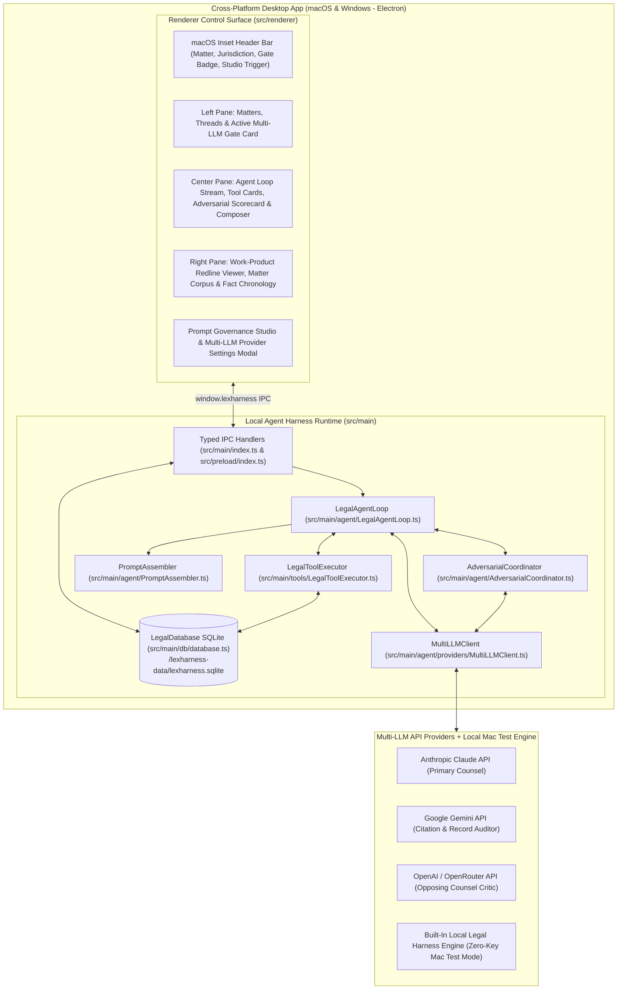

# Architecture & Implementation Plan: LexHarness — Legal Agent Harness Control Surface

## 1. Executive Summary & Core Vision

**LexHarness** is a cross-platform (**macOS and Windows**) desktop application that provides lawyers with a dedicated **Agent Harness Control Surface**—an autonomous, multi-step workspace for legal research, record investigation, citation verification, and work-product drafting:

1. **Local Client Agent Loop**: Runs natively on the lawyer's Mac or Windows machine inside the Electron main process, maintaining matter and thread state in a local SQLite database (`sql.js`), executing local legal tools (`list_matter_documents`, `search_matter_corpus`, `read_document_pages`, `verify_citation_lookup`, `propose_document_redline`, `record_chronology_fact`), and calling LLM provider APIs directly from the client.
2. **User-Governed Legal System Prompts**: All system prompts are purpose-built for legal practice and exposed directly in the application's **Prompt Governance Studio** (Settings). Lawyers have full visibility and editorial control over the 4-layer prompt hierarchy: Core Legal Mandate & Ethical Guardrails, Practice Area Personas, Matter Jurisdiction & Citation Rules, and Adversarial Critic Prompts.
3. **Default Multi-LLM Adversarial Review Gate**: Before any final answer or drafted legal artifact is presented to the user, the local agent loop automatically intercepts the candidate output and routes it in parallel through independent reviewer models (e.g., Anthropic Claude as Primary Counsel, Google Gemini 2.5 Pro as **Citation & Record Auditor**, and OpenAI o3-mini / GPT-4o as **Adversarial Opposing Counsel & Reviewing Partner**) to catch unsupported citations, record mismatches, logical gaps, and drafting risks, forcing an automatic revision pass when material objections are raised.

---

## 2. Clean-Slate Desktop Architecture

The application is built on **Electron 33 + React 18 + Vite 6 + TypeScript 5 + Tailwind CSS + SQLite (`sql.js`)**, running a local orchestration engine and tool runner directly in the Electron Main Process and communicating with the React Control Surface over a typed `contextBridge` IPC layer.



---

## 3. Exact Repository File Structure

To rebuild the application identically from this document, the repository is structured as follows:

```text
free-legal-assist/
├── package.json                                  # Scripts: dev, build, start, package:mac, dist:mac, dist:win, typecheck, test
├── tsconfig.json                                 # Renderer & shared TypeScript config
├── tsconfig.node.json                            # Electron main & preload CommonJS TypeScript config
├── vite.config.ts                                # Vite React renderer config (port 5173, outDir: dist)
├── tailwind.config.js                            # Tailwind CSS config with dark slate/amber legal theme
├── postcss.config.js                             # PostCSS config
├── electron-builder.yml                          # Packaging config for macOS (.dmg/.zip) and Windows (nsis/.zip)
├── index.html                                    # Renderer HTML entry point
├── README.md                                     # Launch & test instructions
├── docs/
│   └── PLAN.md                                   # Architectural & implementation specification
└── src/
    ├── shared/
    │   └── types.ts                              # Shared domain & IPC contracts
    ├── preload/
    │   └── index.ts                              # Electron contextBridge exposing window.lexharness
    ├── main/
    │   ├── index.ts                              # Electron main process, BrowserWindow, safeStorage & IPC handlers
    │   ├── db/
    │   │   ├── defaultLegalData.ts               # Default 4-layer legal prompts & seeded matters/documents/messages
    │   │   └── database.ts                       # SQLite (sql.js) persistence & encrypted provider credentials
    │   ├── agent/
    │   │   ├── PromptAssembler.ts                # 4-layer dynamic legal system prompt composer
    │   │   ├── AdversarialCoordinator.ts         # Parallel Multi-LLM critic evaluation & JSON verdict parser
    │   │   ├── LegalAgentLoop.ts                 # Autonomous tool execution, primary draft, adversarial gate & revision loop
    │   │   └── providers/
    │   │       └── MultiLLMClient.ts             # Anthropic, OpenAI, Gemini, OpenRouter HTTP clients + Local Legal Engine
    │   ├── tools/
    │   │       └── LegalToolExecutor.ts          # 6 local legal tools operating against the Matter SQLite corpus
    │   └── __tests__/
    │       └── legalHarness.test.ts              # Vitest suite verifying SQLite, prompt assembly & adversarial loop
    └── renderer/
        ├── main.tsx                              # React DOM root mount
        ├── styles.css                            # Tailwind directives + macOS -webkit-app-region drag rules
        ├── App.tsx                               # Main 3-pane Legal Agent Control Surface UI
        ├── lib/
        │   └── bridge.ts                         # Typed renderer wrapper around window.lexharness
        └── components/
            ├── PromptGovernanceModal.tsx         # 6-tab modal for Layers 1–4 prompts, API keys & live preview
            └── RightWorkspacePane.tsx            # 3-tab right pane: Work-Product Redline, Matter Corpus & Chronology
```

---

## 4. Domain Data Model & SQLite Schema (`src/shared/types.ts` & `src/main/db/database.ts`)

### 4.1 SQLite Tables (`<userData>/lexharness-data/lexharness.sqlite`)
1. **`matters`**: `id`, `name`, `client_name`, `matter_number`, `practice_area`, `jurisdiction`, `citation_style`, `folder_path`, `created_at`, `updated_at`
2. **`documents`**: `id`, `matter_id`, `title`, `file_name`, `category` (`PLEADING` | `CONTRACT` | `EXHIBIT` | `DEPOSITION` | `STATUTE_AUTHORITY` | `WORK_PRODUCT`), `bates_range`, `page_count`, `summary`, `content`, `created_at`, `updated_at`
3. **`document_versions`**: `id`, `document_id`, `matter_id`, `version_number`, `title`, `content`, `previous_content`, `rationale_summary`, `created_by_model`, `created_at`
4. **`chronology_facts`**: `id`, `matter_id`, `fact_date`, `event_description`, `source_citation`, `status` (`UNDISPUTED` | `DISPUTED` | `NEEDS_CORROBORATION`), `created_at`
5. **`threads`**: `id`, `matter_id`, `title`, `practice_area`, `created_at`, `updated_at`
6. **`messages`**: `id`, `thread_id`, `role` (`user` | `assistant`), `content`, `initial_draft_before_review`, `primary_provider`, `primary_model`, `review_mode_used`, `assembled_system_prompt_snapshot`, `tool_calls_json`, `adversarial_reviews_json`, `revision_rounds_completed`, `created_at`
7. **`key_value_settings`**: Stores JSON settings for `system_prompt_settings` (`SystemPromptSettings`) and `adversarial_config` (`AdversarialConfig`).
8. **`provider_credentials`**: `provider_id`, `encrypted_api_key` (encrypted via Electron `safeStorage` using macOS Keychain / Windows DPAPI), `base_url`, `default_model`, `updated_at`.

### 4.2 Pre-Seeded Legal Matters & Corpus (`src/main/db/defaultLegalData.ts`)
On first launch, `LegalDatabase` seeds:
- **Matter 1**: *Apex Biometrics v. Meridian Cloud Systems* (`2026-CV-04192-DEL`, Delaware Court of Chancery, Bluebook 21st Ed.) with 4 indexed documents:
  1. `01_Master_Services_Agreement_Executed.pdf` (`APEX-0001 to APEX-0024` — §§ 4.1–4.2 biometric HSM encryption, § 8.2 10-Business-Day notice with material-prejudice proviso, § 9.2 $1.8M General Cap, $5.4M 3x Super-Cap for Gross Negligence/Willful Misconduct, and Uncapped tier for Reckless Disregard of Known Cryptographic Vulnerabilities).
  2. `02_Deposition_Marcus_Vance_2026-10-18.pdf` (`MERIDIAN-DEP-0001 to 0088` — Rule 30(b)(6) admissions at pp. 41 & 59).
  3. `03_Delaware_Authority_Compendium.md` (`AUTH-DEL-0001 to 0012` — *Abry Partners*, *Jardel Co. v. Hughes*, *Express Scripts v. Bracket Holdings*, *Salamone v. Gorman*).
  4. `04_Draft_SJ_Brief_Liability_Cap_Analysis.md` (`WP-APEX-0001` — Work product with Version 1 pre-review and Version 2 post-adversarial cured snapshots).
- **Matter 2**: *Helios Energy — Series C & Commercial Licensing* (`2026-TX-08814-NY`, New York Commercial Division).

---

## 5. Core Pillar 1: 4-Layer User-Governed Legal System Prompts (`PromptAssembler.ts`)

Every agent turn dynamically composes the system prompts from four user-editable layers managed in `PromptGovernanceModal.tsx`:

1. **Layer 1 — Core Legal Mandate & Ethical Guardrails**:
   - Strict anti-hallucination and grounding mandate; mandatory Bates/section/page:line source pinpoints; explicit `[UNVERIFIED AUTHORITY]` flagging; distinction between binding and persuasive authority; candid risk assessment; CRAC/IRAC analytical structure.
2. **Layer 2 — Practice Area Personas (`PracticeAreaPreset[]`)**:
   - `litigation_appellate` (*Litigation & Appellate Brief Counsel*)
   - `transactional_contracts` (*Transactional & Commercial Contracts Counsel*)
   - `regulatory_compliance` (*Regulatory & Statutory Compliance Counsel*)
   - `discovery_investigation` (*Discovery & Fact Chronology Investigator*)
3. **Layer 3 — Matter Jurisdiction, Forum & Citation Rules**:
   - Injects the active Matter's `name`, `clientName`, `matterNumber`, `jurisdiction`, `citationStyle`, and `folderPath`.
4. **Layer 4 — Adversarial Reviewer System Prompts**:
   - **Layer 4A (`criticCitationAuditorPrompt`)**: Instructions for the Independent Citation & Record Auditor.
   - **Layer 4B (`criticOpposingCounselPrompt`)**: Instructions for the Adversarial Opposing Counsel & Senior Reviewing Partner.

---

## 6. Core Pillar 2: Default Multi-LLM Adversarial Review Loop (`LegalAgentLoop.ts` & `AdversarialCoordinator.ts`)

```mermaid
sequenceDiagram
    participant Lawyer as Supervising Attorney (UI)
    participant Loop as LegalAgentLoop (Main Process)
    participant Tools as LegalToolExecutor (SQLite Corpus)
    participant Primary as Primary Model (e.g. Claude)
    participant Critics as Parallel Critics (Gemini Auditor + OpenAI Opposing Counsel)

    Lawyer->>Loop: Run Turn (userPrompt, reviewMode, practiceArea)
    Loop->>Loop: Assemble 4-Layer Legal System Prompts (PromptAssembler)
    Loop->>Tools: Execute search_matter_corpus & verify_citation_lookup
    Tools-->>Loop: Grounded excerpts + Bates pinpoints
    Loop->>Primary: Generate Initial Candidate Legal Draft
    Primary-->>Loop: initialDraftBeforeReview
    alt reviewMode != 'direct_bypass'
        par Parallel Independent Critique
            Loop->>Critics: Critic #1 (Citation & Record Auditor)
            Loop->>Critics: Critic #2 (Opposing Counsel & Reviewing Partner)
        end
        Critics-->>Loop: Structured JSON Verdicts (APPROVE | REVISE + Objections)
        alt Any Critic Returns REVISE (MEDIUM/CRITICAL)
            Loop->>Primary: Revision Pass with Critic Objections + Tool Evidence
            Primary-->>Loop: Cured Final Legal Work Product
            Loop->>Tools: propose_document_redline (Save Version Snapshot)
        end
    end
    Loop-->>Lawyer: Persist & Render Final Work Product + Adversarial Scorecard + Redline Diff
```

### Supported Multi-LLM Providers (`MultiLLMClient.ts`)
- `anthropic` (`https://api.anthropic.com/v1/messages`)
- `openai` (`https://api.openai.com/v1/chat/completions`)
- `gemini` (`https://generativelanguage.googleapis.com/v1beta/models/{model}:generateContent`)
- `openrouter` (`https://openrouter.ai/api/v1/chat/completions` or custom local base URL)
- `legal-simulator`: Built-in deterministic local legal engine that grounds drafts in the active Matter's SQLite corpus and executes a realistic 2-critic adversarial audit + revision pass when external API keys are not yet configured.

---

## 7. Core Pillar 3: Scoped Local Legal Tool Suite (`LegalToolExecutor.ts`)

| Tool Name | Execution Behavior |
| :--- | :--- |
| `list_matter_documents` | Lists all documents in the active Matter with category, Bates range, page count, and summary. |
| `search_matter_corpus` | Keyword/term scoring search across all documents in the active Matter, returning matched excerpts with Bates ranges. |
| `read_document_pages` | Reads full text and Bates pinpoints for a specified `documentId` or filename. |
| `verify_citation_lookup` | Cross-checks cited authorities against the Matter's `STATUTE_AUTHORITY` compendium and flags any unverified authority. |
| `propose_document_redline` | Saves a new `DocumentVersion` snapshot in SQLite (`previousContent` vs. `content`) and updates the work-product document so the right-hand Redline Viewer displays struck and inserted paragraphs. |
| `record_chronology_fact` | Inserts a dated `ChronologyFact` with source pinpoint citation and `UNDISPUTED` / `DISPUTED` / `NEEDS_CORROBORATION` status. |

---

## 8. Build, Verification & Cross-Platform Packaging Commands

1. **Install Dependencies**: `npm install`
2. **Typecheck & Unit Tests**: `npm run typecheck && npm test`
3. **Production Build**: `npm run build`
4. **Package Native macOS App Bundle (`release/mac-arm64/LexHarness.app`)**: `npm run package:mac`
5. **Package Distributable Installers**: `npm run dist:mac` (macOS `.dmg`/`.zip`) or `npm run dist:win` (Windows NSIS `.exe`/`.zip`).
